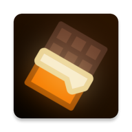
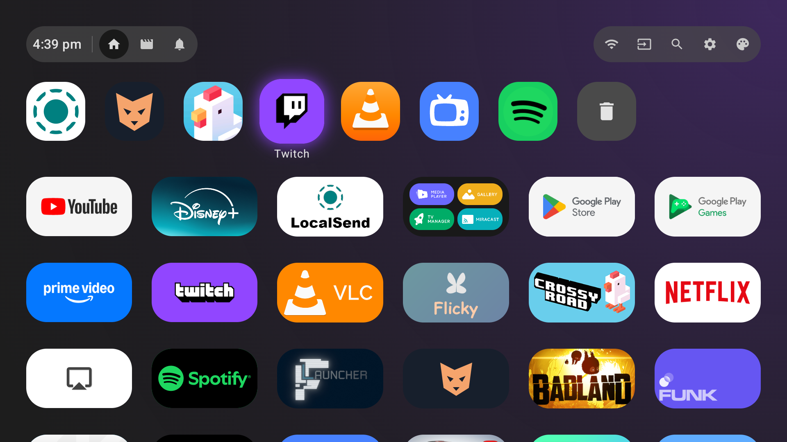
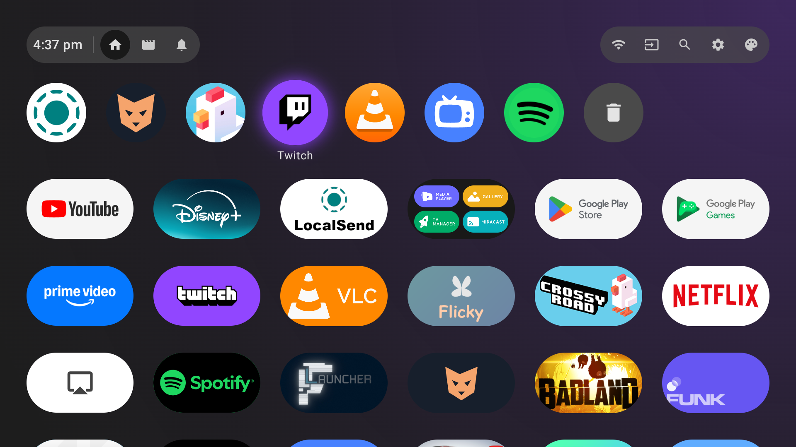
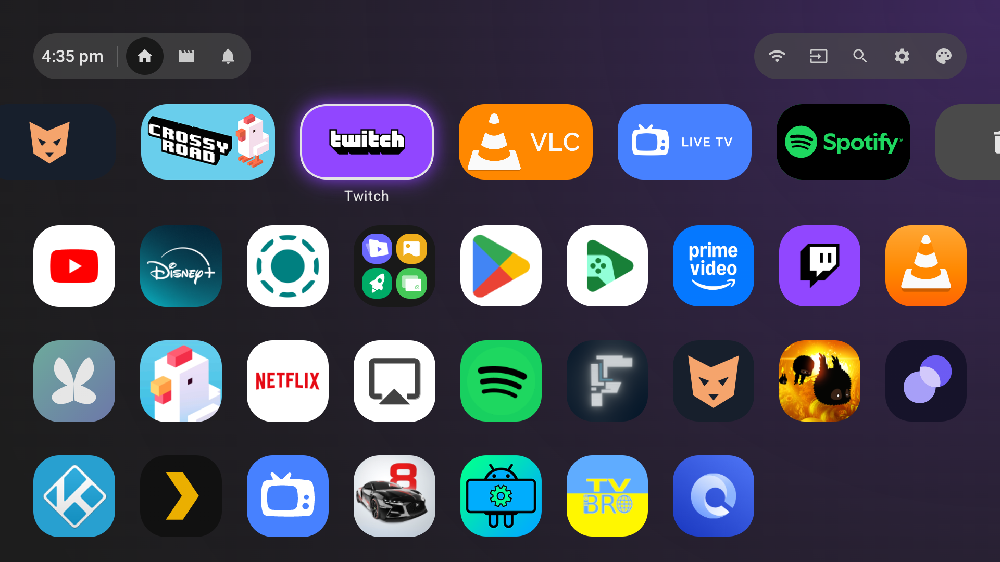
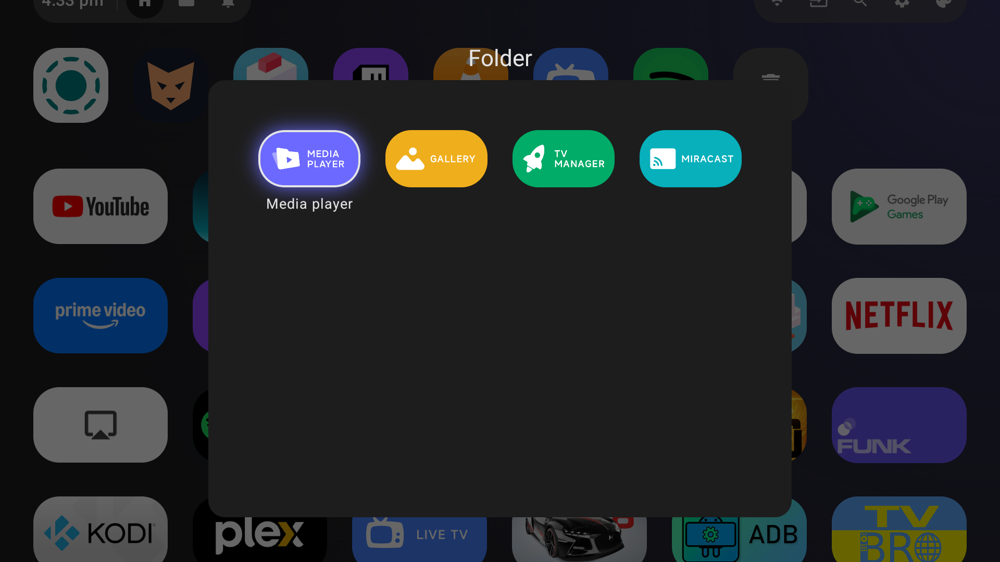
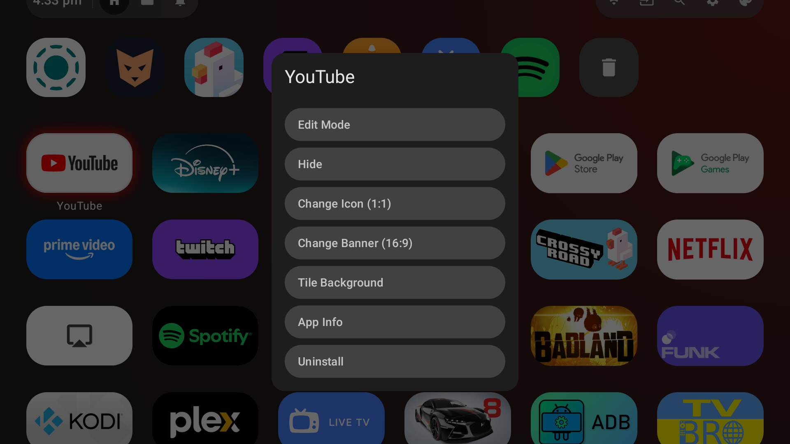
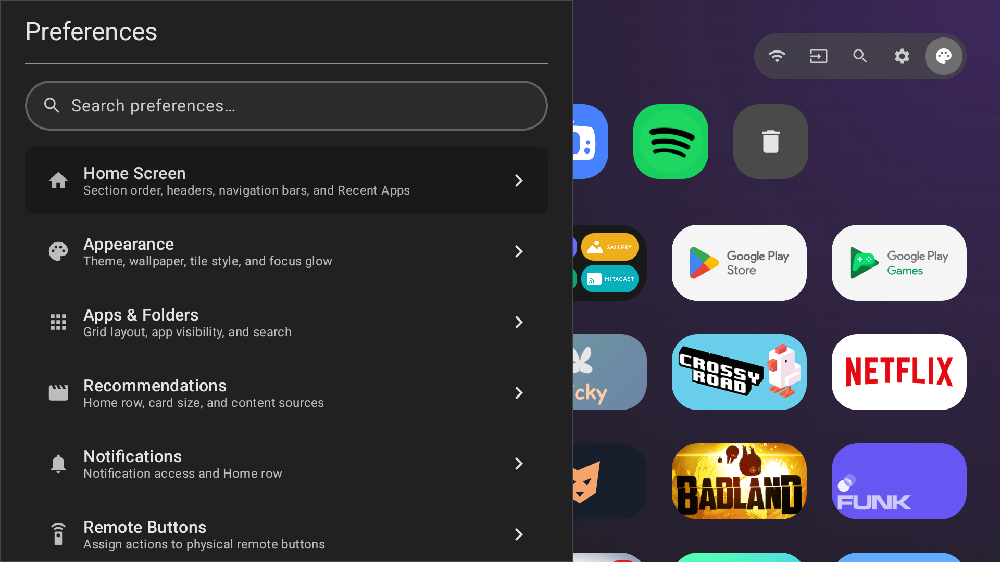

# Chocolate TV Launcher

Chocolate is a customizable home launcher for Android TV and Google TV. It is built in Kotlin with Jetpack Compose for TV and designed for D-pad navigation.

## Screenshots



<details>
<summary>More screenshots</summary>

| Alternate home layout | Square app tiles |
| --- | --- |
|  |  |
| **App folder** | **App actions** |
|  |  |
| **Preferences** | |
|  | |

</details>

## Features

- Reorder apps, create folders, hide apps, and customize tile artwork and colors.
- Search installed apps and launcher preferences.
- Customize the navigation bars, recent apps, section headers, focus glow, and idle dimming.
- Remap physical remote buttons to actions such as launching an app, opening Chocolate Preferences, or taking a screenshot on supported devices.
- Export selected settings to a JSON file in Downloads and choose what to restore when importing it.

## Install on a TV

Download the APK from this repository’s **Releases** page when a release is available. Sideload the APK using the TV’s installer or Android Debug Bridge. The Android package ID is `com.kvendy.chocolatetvlauncher`.

Open Chocolate and use **Preferences → System → Set as Default Launcher** if you want to make it your Home app. Available launcher settings vary by TV firmware.

To remap physical buttons, go to **Preferences → Remote Buttons** and enable the Chocolate accessibility service in Android Settings. Some TV firmware intercepts keys before Android delivers them to the app. Screenshot capture runs when you press a button assigned to **Take Screenshot**.

## Build from source

Open this directory in Android Studio, install Android SDK Platform 36, and use a JDK supported by the Gradle wrapper. From the repository root, run:

```sh
./gradlew :app:assembleDebug :app:testDebugUnitTest
```

The debug APK is written to `app/build/outputs/apk/debug/`. Use `./gradlew :app:assembleRelease` to build an unsigned release APK.

## Third-party notices

The ADB client library notice is bundled in [adblib.txt](app/src/main/assets/licenses/adblib.txt).
